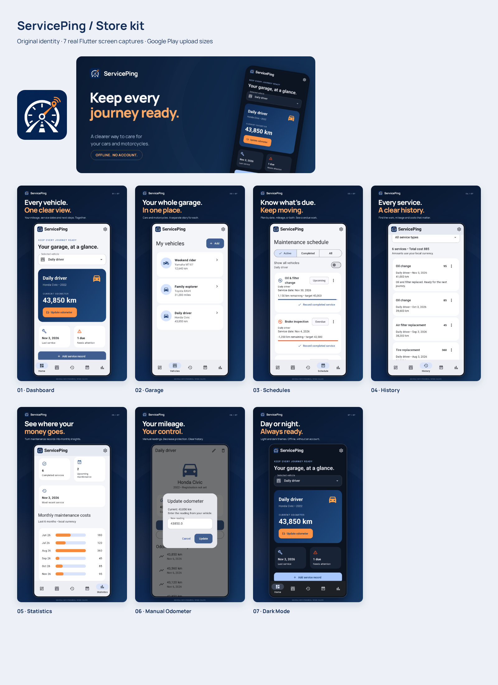

# ServicePing — Complete Store Kit

A consistent navy/orange identity and Google Play listing kit, with real Flutter screenshots and an editable privacy policy.

**Download everything:** [ServicePing-Store-Kit.zip](ServicePing-Store-Kit.zip)

## Upload files

- **Logo:** [512 × 512 Play icon](branding/app-icon-512.png), [1024 × 1024 icon](branding/app-icon-1024.png), [original master](branding/logo-master.png).
- **Feature graphic:** [1024 × 500 PNG](branding/feature-graphic-1024x500.png).
- **Seven screenshots:** [Numbered 1080 × 1920 PNGs](screenshots/play-store/).
- **Store listing:** [Editable DOCX](listing/complete-store-listing.docx), [PDF](listing/complete-store-listing.pdf), [copyable Markdown](listing/complete-store-listing.md), plus individual TXT fields.
- **Privacy policy:** [Editable DOCX](privacy/privacy-policy.docx), [PDF](privacy/privacy-policy.pdf), [HTML](privacy/privacy-policy.html), [Markdown](privacy/privacy-policy.md), and plain text.
- **Upload help:** [Roman Urdu / English upload guide](UPLOAD-GUIDE.md), [Data safety guide](listing/data-safety-guide.md).
- **Offline preview:** download [review-gallery.html](review-gallery.html) and open it in a browser.

The temporary email is **support@serviceping.example**, a reserved, non-deliverable placeholder. Replace it before publication. A public HTTPS privacy webpage must also be hosted; `docs/privacy/index.html` is ready for hosting but has not been deployed.

Policy contact, effective date and sections come from [source/policy.json](source/policy.json). The app's offline Privacy screen uses that same file. Editable visual layouts, fonts/licenses, capture tooling and document-generation scripts are included for future updates.

Screenshots contain fictional demo vehicles and service records. Production app data is unaffected. No store listing has been submitted or published.
